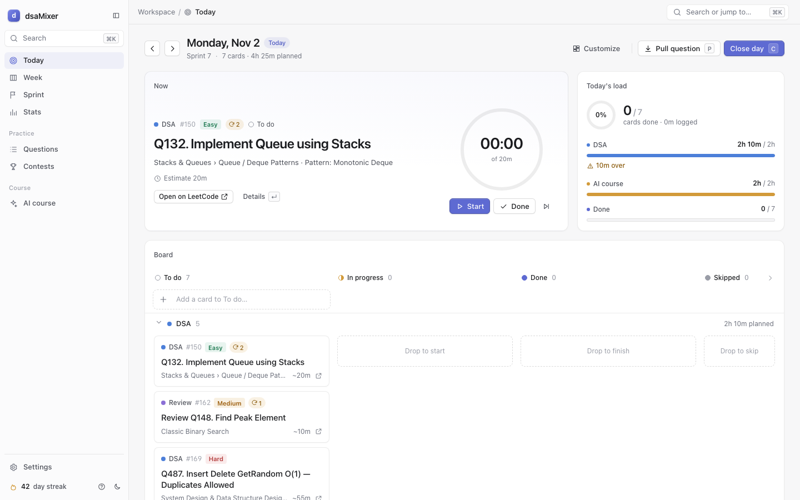
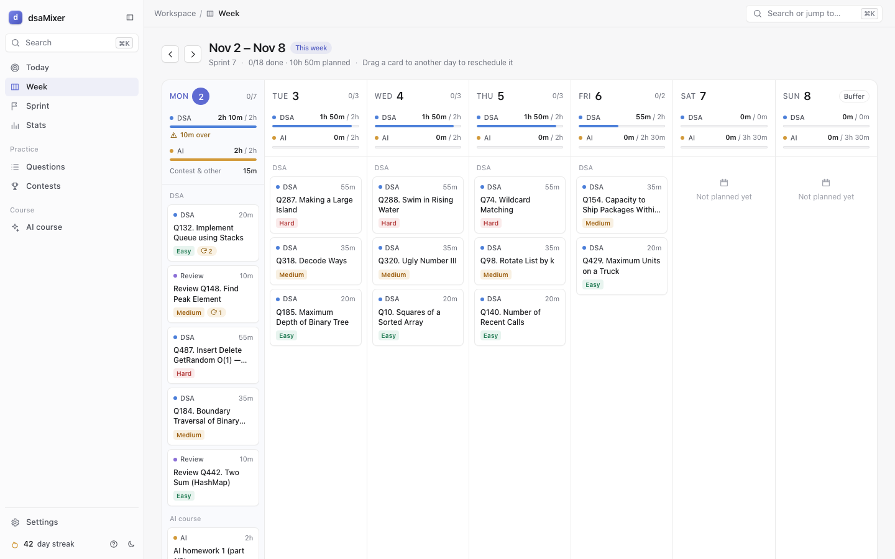
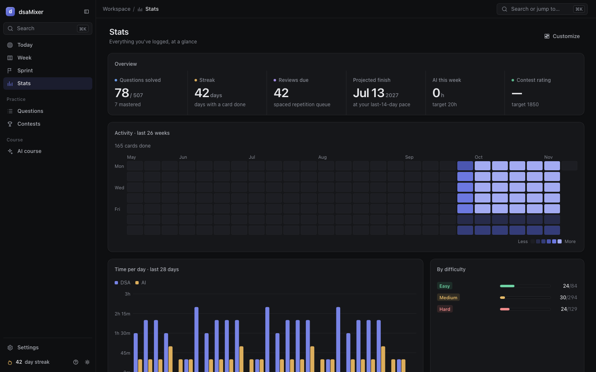
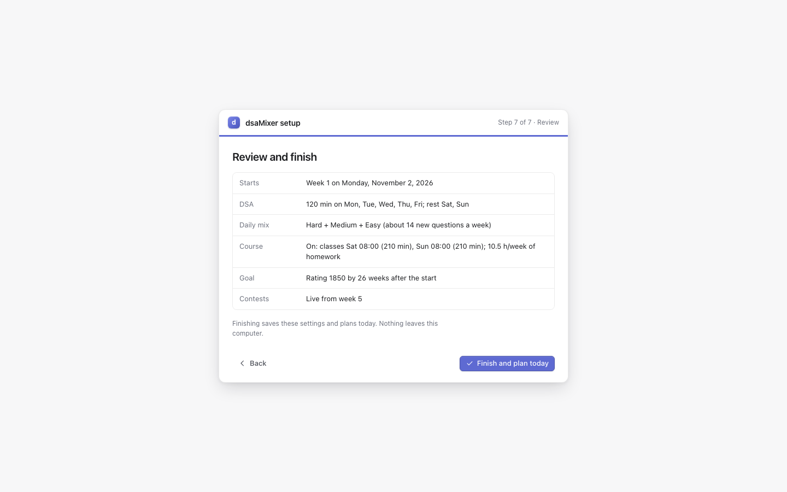

# dsaMixer

dsaMixer is a local daily planner for interview prep. It takes a list of 507 DSA questions and lays out a fresh board every day: a mix of difficulties from different topics, spaced-repetition reviews when they come due, LeetCode contests on the right weekends, and, if you follow a course, its classes and homework next to the DSA. You work through the cards, log them in the evening, and it plans tomorrow from what is left. Everything runs on your own machine, with no account and no API key needed.

New here? [docs/showcase.md](docs/showcase.md) is the two-minute tour: every feature in one line, and how to start.



| Week view | Stats (dark) | First-run setup |
|---|---|---|
|  |  |  |

## Quickstart

You need macOS or Linux and Python 3.10 or newer. On Windows, use [WSL](https://learn.microsoft.com/windows/wsl/install).

**Recommended, with [Claude Code](https://claude.com/claude-code):**

```sh
git clone https://github.com/prathamjain0016/dsaMixer.git
cd dsaMixer
claude
```

Then type `/setup`. It checks your machine, installs the packages, asks about your schedule and goal, saves your plan, tells you which `.env` variables to fill for the extras you want (it never reads `.env` or asks for keys in the chat), and starts the board.

**Alternative, in the browser:**

```sh
git clone https://github.com/prathamjain0016/dsaMixer.git
cd dsaMixer
./run.sh
```

Open <http://127.0.0.1:8765>. The first run creates a Python environment in `.venv` (about a minute), stores your data in `dsamixer.db` (SQLite), and shows a short setup wizard: start date, DSA minutes and rest days, daily mix, your course (or none), and your contest goal (badge target and an optional LeetCode username). Finishing it plans today.

[docs/guides/getting-started.md](docs/guides/getting-started.md) walks through both paths.

## Features

- **A daily board** (To do, In progress, Done) with lanes for DSA, reviews, course work and contests, a timer, and keyboard shortcuts (`?` lists them).
- **Topic mixing:** every new question on a day comes from a different topic, picked from a weighted rotation over the 13 sections.
- **Spaced repetition:** solved questions come back after 3, 7, 21 and 45 days (sooner if you needed hints), until they are mastered.
- **Carry-over:** whatever you didn't finish moves to the next day automatically.
- **LeetCode contests:** virtual contests in the first weeks, then the live Weekly and Biweekly, with upsolve cards for what you missed. The real contest schedule is synced from LeetCode.
- **Your LeetCode profile (optional):** add your username and the board shows a profile card, keeps the badge tracker's rating current, logs the contests you take automatically, and offers to mark questions you recently solved on LeetCode. Add friends' usernames for a small leaderboard on the Contests page.
- **A badge target of your choice:** Knight (~1850), Guardian (~2150) or any rating, with a deadline.
- **A second track for a course:** class and homework cards from your own schedule, or switched off entirely.
- **Week, Sprint and Stats views:** the week at a glance, a weekly retro, a heatmap, topic coverage and a projected finish date.
- **Optional extras:** a weekly AI planner that breaks your goals into tasks, morning and evening emails, and Claude Code agents that plan and track homework.

## How it plans your day

A day is planned once, when you first open it (and tomorrow when you close today):

1. Unfinished cards from earlier days move onto it.
2. Course cards come from your weekly template, unless a weekly AI plan or the homework agent has planned that day.
3. Contest cards are laid out for the rest of the week up front (like the DSA mix), and a short retro card goes on Sunday.
4. New DSA questions fill your daily mix (for example Hard + Medium + Easy), each from a different topic, then due reviews and extra Mediums fill the rest of your DSA minutes.

The details, with every rule, are in [CLAUDE.md](CLAUDE.md#how-a-day-is-planned-plannerplan_day).

## Optional integrations

None of these are needed. Keys go in a `.env` file that you create from `.env.example` and fill in yourself; it is git-ignored, and the app never asks for keys in the browser.

| Integration | What you add to `.env` | Guide |
|---|---|---|
| Weekly AI planner (AI course tab) | `OPENROUTER_API_KEY` and `OPENROUTER_MODEL`, or `ANTHROPIC_API_KEY` | [integrations.md](docs/guides/integrations.md#weekly-ai-planner) |
| Morning and evening emails | `SMTP_USER`, `SMTP_PASSWORD` (a Gmail app password) and `MAIL_TO` | [integrations.md](docs/guides/integrations.md#email-reminders-gmail) |
| Postgres instead of SQLite | `DATABASE_URL` | [integrations.md](docs/guides/integrations.md#postgres-instead-of-sqlite) |
| Claude Code homework agents | nothing; you need the `claude` CLI | [homework-agents.md](docs/guides/homework-agents.md) |

`./run.sh setup status` shows which ones are configured (true or false, never the values). `notebooks/connection_check.ipynb` tests each one and reports PASS, FAIL or SKIP.

## Customising

- **Settings tab:** budgets, time estimates, contests, LeetCode (username, friends, badge target), and the full config as JSON under Advanced. **Run setup again** reopens the wizard with your current answers.
- **A config file:** copy [config.example.json](config.example.json) to `config.local.json` (git-ignored), keep only the keys you want to change, and run `./run.sh config import config.local.json`.
- **Claude Code:** `/setup --reconfigure`.

[docs/guides/customise.md](docs/guides/customise.md) documents every key and its default.

## Commands

Everything goes through `./run.sh`, which creates `.venv`, installs `requirements.txt` when it changes, and runs `python -m dsamixer`.

| Command | What it does |
|---|---|
| `./run.sh` | Start the board at <http://127.0.0.1:8765> (same as `./run.sh serve`; `--port` and `--host` are available). |
| `./run.sh today` | Print today's plan in the terminal. |
| `./run.sh setup status` | JSON: whether setup is done, the database in use, whether `.env` exists, which integrations are configured, Python, OS, and whether the board is running. |
| `./run.sh config import FILE` | Validate a full or partial config JSON, merge it over your config and save it. |
| `./run.sh config export [FILE]` | Print or save the effective config. |
| `./run.sh plan week [FROM] [--dry-run]` | Re-lay the DSA from FROM (default tomorrow) to Sunday. |
| `./run.sh contests sync` / `upcoming` | Fetch LeetCode's upcoming contests into the cache / print the cache. |
| `./run.sh leetcode sync` | Sync your LeetCode profile (needs `leetcode.username`): rating, auto-logged contests, "already solved" suggestions. |
| `./run.sh leetcode profile USER` | Print any LeetCode user's profile as JSON, without storing anything. |
| `./run.sh notify morning\|evening [--dry-run]` | Send (or preview) the morning plan or the evening reminder. |
| `./run.sh schedule install\|remove` | macOS only: the board at login, emails at 8:00 and 22:00, homework sync at 14:00 and 21:30. On Linux, use cron ([example](docs/guides/integrations.md#scheduling-the-emails)). |
| `./run.sh db info` | Which database is in use, with row counts. |
| `./run.sh db copy-from-sqlite [FILE] --yes` | Replace all Postgres data with a SQLite file. |
| `./run.sh homework week [N]`, `nbscan`, `pdftext`, `apply` | Helpers for the homework agents (JSON). |
| `./run.sh tickets list\|add\|update` | Read and edit cards from the terminal (JSON). |

In Claude Code: `/setup`, `/homework-plan [course week]` and `/homework-sync [course week]`.

## Project structure

```
dsaMixer/
├── run.sh                    the one command that runs everything
├── config.example.json       every config key with its default (see docs/guides/customise.md)
├── .env.example              optional keys; copy to .env
├── CLAUDE.md                 how it works inside, for Claude Code and contributors
├── dsamixer/
│   ├── cli.py                every ./run.sh command
│   ├── core/                 db.py (SQLite or Postgres, schema), config.py (defaults, validation, setup)
│   ├── planning/             planner.py (plan a day, mix, spaced repetition, contests), stats.py
│   ├── integrations/         ai_planner.py, notify.py (email), leetcode.py, homework.py
│   ├── web/                  server.py (JSON API under /api) and static/ (the UI, vanilla JS)
│   └── data/questions.json   the 507 questions
├── homework/                 your course homework, one folder per course week (git-ignored)
├── notebooks/                connection_check.ipynb
├── docs/                     guides, architecture, specs (index: docs/README.md)
└── .claude/                  the homework agents and the /setup, /homework-plan, /homework-sync commands
```

## Contributing

- The UI is vanilla ES modules with no framework and no build step. `node --check` each file in `dsamixer/web/static/js/` to catch syntax errors.
- SQL is written once, SQLite style, and kept portable to Postgres. CLAUDE.md lists the rules.
- Imports go one way: `core` ← `planning` ← `integrations` ← `web`/`cli`.
- Test on a scratch database, never your real one: `cp dsamixer.db /tmp/t.db && DSAMIXER_DB=/tmp/t.db ./run.sh today`, or point `DSAMIXER_DB` at a new file for a fresh install.
- `CLAUDE.md` is the developer guide; `docs/README.md` indexes the rest.

## Credits

The 507 questions in `dsamixer/data/questions.json` come from the DSA question list ("DSA Questions and Patterns") shared in the course. The PDF itself is not in the repo.

## License

[MIT](LICENSE) © Pratham Jain
