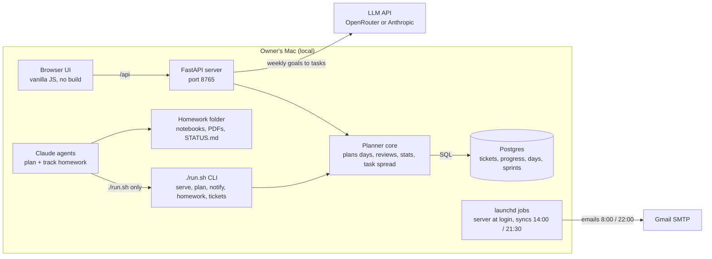
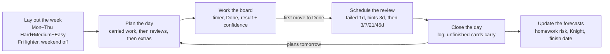

# dsaMixer system documentation

As of 2026-11-02. For the conventions to follow when changing code, see `CLAUDE.md`.

## Overview

dsaMixer turns two study tracks into one daily Kanban board. Every night it re-plans from what you actually finished.

- **DSA:** 507 interview questions parsed from a PDF (84 Easy, 294 Medium, 129 Hard, in 13 sections), with spaced repetition and LeetCode contests. The default goal is the Knight badge (rating ~1850) 26 weeks after the start date; the badge target (Knight, Guardian or a custom rating) and deadline are set in the setup wizard or Settings.
- **AI course:** about 20 hours a week: a live class Sat and Sun 8:00–11:30 IST, plus two homeworks of about 4 hours each.

The stack is FastAPI, Postgres (SQLite for tests) and a vanilla-JS UI. It runs as a single-user app on one Mac.

The daily loop:

1. Today is planned the first time you view it.
2. You move cards across To do, In progress and Done. Finishing a DSA card asks for the result, the minutes spent and your confidence.
3. In the evening, Close day logs your energy, AI topics and notes.
4. Unfinished cards carry forward, and tomorrow is planned around them and around the reviews that have come due.

## System design

dsaMixer runs entirely on the owner's Mac. The only network calls go to an LLM API and Gmail.

The browser and the CLI are two ways into the same planner core. The board, the scheduled jobs and the Claude agents all change data through the same code paths.

## Backend

The backend is plain Python with raw SQL and no ORM. The planner makes every scheduling decision; the API only exposes it.

**API** (`web/server.py`)

| Group | Endpoints |
| --- | --- |
| Day | `GET /api/day/{day}` (plans today on first view) · `POST .../close` · `.../replan` · `.../pull` |
| Week | `GET /api/week/{day}` (read-only, never plans) |
| Tickets | `PATCH`, `POST`, `DELETE /api/tickets` |
| Sprint and stats | `GET`/`PATCH /api/sprint/{n}` · `GET /api/stats` |
| Practice | `GET /api/questions` · `GET`/`POST`/`DELETE /api/contests` (logging a contest adds upsolve cards) |
| Contest calendar | `GET /api/contests/upcoming` (cache only, never fetches) · `POST /api/contests/sync` (502 if LeetCode is unreachable) |
| LeetCode profile | `GET /api/leetcode/profile` (cache only, with open suggestions) · `POST /api/leetcode/sync` (404 unknown user, 502 unreachable) · `GET /api/leetcode/friends[?refresh=1]` (6-hour cache) · `POST /api/leetcode/suggestions/{num}/accept`, `/{num}/dismiss`, `/accept-all` |
| AI course | `/api/ai-modules` (syllabus) · `GET /api/ai-week` · `POST .../preview` · `POST .../apply` |
| Settings | `GET`/`PUT /api/settings` |

**Storage.** `db.connect()` returns Postgres when `DATABASE_URL` is set, and SQLite otherwise or when `DSAMIXER_DB` forces it. SQL is written once in SQLite style, and a thin `PgConn` wrapper translates it for Postgres (`?` becomes `%s`, `datetime('now','localtime')` becomes `localtimestamp`).

New SQL has to stay portable:
- use `ON CONFLICT` instead of `INSERT OR IGNORE`
- use `RETURNING id`
- put `AS` on every alias
- ship any schema change with an `ALTER TABLE` guard in `init()`

| Table | Holds |
| --- | --- |
| `questions` | The 507 questions |
| `progress` | Spaced-repetition state per question: status, step, next review, last confidence |
| `tickets` | One card per day. `kind`: dsa, review, ai, contest, upsolve, retro or custom. `status`: todo, doing, done or skipped. `source`: none, ai_plan or homework |
| `days` | When the day was planned, laid out (`dsa_laid_at`) and closed, plus the evening log |
| `sprints` | One per Mon–Sun week, with goal and retro |
| `contests` | Q1–Q4 solved, rank and rating. Rows auto-logged from your LeetCode profile have notes starting "auto-logged from LeetCode" |
| `ai_week_plans`, `ai_modules` | Weekly AI plans and the syllabus |
| `settings` | Saved config (merged over the defaults) and the topic-rotation position |

**Planning a day** (`plan_day`, which runs once per day):

1. Carry over unfinished cards.
2. Lay out the week's DSA mix if that hasn't been done yet, then the week's contest cards (`plan_week_contests`): like the mix, contests are laid out for the whole week up front, so the Week view shows them early.
3. Add AI cards, from the weekly plan or the template.
4. Add the retro card.
5. Fill the remaining DSA budget with due reviews, then extra Mediums.

Spaced repetition runs when a DSA or review card first reaches Done.

The stats module computes:
- counts by difficulty and section, and the weakest subtopics
- a 182-day heatmap and the streak
- AI hours against the 20-hour target
- homework progress
- the badge tracker (Knight, Guardian or a custom rating; the current rating comes from the synced LeetCode profile when there is one, else the latest logged contest)
- the projected finish date

## Frontend

The UI is vanilla ES modules with no framework and no build step. The browser and `node --check` are the only tooling, and saving a file ships the change. That suits a one-person local app. The cost is that views build HTML strings and have to escape user text themselves.

| Part | What it does |
| --- | --- |
| Shell (`index.html`, `main.js`) | Collapsible sidebar that becomes a drawer below 768 px. Hash router with one lazily loaded view per route; each view exports `render(root, arg)` and optionally `destroy()` |
| Command palette (`palette.js`) | ⌘K fuzzy search over pages, actions, dates ("tomorrow", "+3") and all 507 questions |
| Components (`components/`) | Shared builders (Button, Badge, Card, Widget, Meter, ProgressRing, Table, SlideOver) so every page looks and behaves the same |
| Widget layout (`layout.js`) | Reorder, hide or resize widgets on Today and Stats. The layout is saved per browser in localStorage |
| Card panel (`ticket-panel.js`) | Slide-over to edit status, estimate, time spent, date, result, confidence, link and note, with a timer and delete |
| Close day | A 3-step slide-over (review, evening log, confirm) that then opens tomorrow |
| Timer and keys (`timer.js`, `keys.js`) | One timer kept in localStorage that writes minutes back to the card. Keys 1–8 and g+letter switch pages; j/k, Enter, n, p and c work on the board |

## AI integration

AI is used in two places: an LLM inside the app breaks weekly goals into tasks, and Claude Code agents drive the app's CLI to plan and track homework.

**LeetCode contest sync** (`integrations/leetcode.py`)

`sync()` calls LeetCode's public, read-only GraphQL `upcomingContests` and merges the result into the `leetcode_contests` setting (21 days kept). The planner only reads that setting, so `planning` never imports `integrations`. It runs in a background thread at server start, before `notify morning` (the 8:00 launchd job), from `./run.sh contests sync` and from the Contests page. A failure is logged and never blocks startup.

**LeetCode profile** (`integrations/leetcode.py`)

With `leetcode.username` set, `sync_profile()` fetches your public profile from the same endpoint (one GraphQL query: profile, solved counts, badges, streak, contest ranking and history, the ~20 most recent accepted submissions) and:
1. caches it in the `leetcode_profile` setting (the profile card and the badge tracker read it);
2. logs each attended Weekly/Biweekly on or after `start_date` that isn't in `contests` yet (matched by name), assuming the solved problems were Q1, Q2, … in order, and adds an upsolve card through `planner.add_upsolve` when not all were solved;
3. matches recent accepted titles to the question list (lowercase, parentheticals and punctuation removed; `difflib` ratio ≥ 0.9 as a fallback) and stores the matches in `leetcode_suggestions`, minus questions that aren't `new` and ones in `leetcode_dismissed`. Accepting one marks a dsa ticket done today through `planner.update_ticket` (confidence 4, no hints), so spaced repetition schedules the single 21-day check.

It runs best-effort right after the contest sync (server start thread, `notify morning`), and from `./run.sh leetcode sync` and the profile card's Refresh. `fetch_friends()` fetches `leetcode.friends` one at a time into `leetcode_friends_cache` (6 hours per username; a failing username becomes an error row). `integrations` imports `planning` here, never the other way round.

**In-app weekly planner** (`integrations/ai_planner.py`)

1. **Breakdown, done by the LLM.**
   - You type the week's goals. One structured-output call returns `{summary, tasks: [{goal, title, minutes}]}`: ordered tasks of 30–90 minutes each.
   - The provider comes from env: OpenRouter (`OPENROUTER_MODEL`) when its key is set, otherwise Anthropic.
   - API errors (401, 402, 429, cut-off output) become clean HTTP errors.
2. **Scheduling, done without the LLM.**
   - `distribute()` places the tasks with dynamic programming over the days, keeping each goal's steps in order.
   - A day's cost is 1000 × minutes over capacity, plus the squared distance from an even share, plus a small pull toward earlier days.
   - Plans with up to 600 states are solved exactly, with a pace term (weight 2000) so every goal moves forward.
3. **Apply.** The tasks become cards (`source='ai_plan'`) and replace the generic AI template cards for those days.

Why the split: breaking goals into steps is language work, and the model does it well. Scheduling is arithmetic under hard capacity limits, where a model can miscount minutes or reorder steps. Deterministic code is repeatable and testable.

**Claude Code agents**

| Agent | Model | Job |
| --- | --- | --- |
| `homework-planner` | Claude Opus 5.5 | Turns a week's homework folder into steps, cards and `STATUS.md` |
| `homework-tracker` | Claude Sonnet 5.5 | Checks notebooks for evidence, ticks steps and marks cards done. Also runs headless at 14:00 and 21:30 |
| `ui-polisher` | Claude Opus 4.8 | Visual-only UI passes |

Development follows the same split: Opus plans and reviews, and Sonnet subagents implement from a precise spec.

## Homework environment

Homework files from the course become a checklist and board cards. The agents plan and track the work; they never do it.

- **Folders.** `homework/weekN/` is named by course week. `course_week_offset` (3) maps course week 4 to sprint 1, which is Mon 2 Nov to Fri 6 Nov. The deadline is Saturday 08:00, before class, unless the assignment states another.
- **`STATUS.md` is the contract.**
  - A header holds the deadline, last sync, progress and risk.
  - Each step is one line, like `- [ ] HW1-Q2 title · 60m · #16`.
  - The log at the bottom is append-only.
- **Evidence.**
  - `nbscan` parses the notebook JSON without running it. For each code cell it reports `has_work`, `executed` and `error`.
  - A cell containing only a placeholder (`TODO`, `YOUR CODE HERE`, `pass`, `...`) counts as no work.
  - A step is ticked only when its cells have work, were run and show no error.
- **Planner agent.** Splits each homework into steps of 30–90 minutes and applies them as cards. Re-running it keeps card ids stable and never touches steps you've started.
- **Tracker agent.**
  - Ticks steps, marks cards done, recomputes progress and risk, and appends a log line.
  - Adds one catch-up card, and only when risk is `behind`.
  - Never reopens, deletes or reschedules a card you've touched.
- **Scheduled sync.** launchd runs the tracker headless at 14:00 and 21:30 with `--permission-mode dontAsk`. Project permissions allow only `./run.sh` commands and edits to `homework/**/STATUS.md`, and they deny reading `.env`.
- **Hard rules.** Agents never write solutions, never modify notebooks or PDFs, and use the CLI, never raw SQL.
- **Kernels.** Notebooks run in the course's own kernels (`ai-learn2-py314`, `ai-engg-rag`), separate from the app's `.venv`. Run the cells and save the notebook so the progress counts.

## What makes it intelligent

The intelligence is a feedback loop of fixed, testable rules: each night's plan is built from what you actually finished. No model is involved except the optional weekly AI breakdown.

| Rule | How it works | Numbers |
| --- | --- | --- |
| Topic rotation | Smooth weighted round-robin over the 13 sections. Each slot comes from a different topic, and topics follow PDF order | Graphs, DP and Trees count double, so a full cycle is 16 slots |
| Weekly layout | The Mon–Fri mix goes on the board on the first planned weekday. Friday is lighter so it can absorb leftovers | 14 new questions a week; Mon–Thu use 110 of 120 min |
| Rest days | No new questions, reviews or carried DSA on Sat and Sun | Leftovers wait for Monday |
| Budget-aware fill | Carried work uses the budget first, then due reviews, then extra Mediums if they fit | Reviews are 10 min (1–3 a day); extras are 35 min |
| Spaced repetition | The next review is set by the result and your confidence | Failed: 1 day. Hints or confidence ≤2: 3 days. Confident first solve: one check at 21 days. Then 3, 7, 21 and 45 days until mastered |
| Contest progression | Steps up over the weeks; unsolved problems become upsolve cards | Virtual in weeks 1–4, live Weekly from week 5, Biweekly from week 9; 45 min per upsolve. Real names and times (and Biweekly dates) come from the synced LeetCode cache; `biweekly_anchor` is the fallback |
| Homework risk | Minutes left vs. AI capacity before the deadline. At `behind`, one catch-up card is added | watch above 80%, behind above 100% |
| Projected finish | Remaining questions at the pace of the last 14 days. Before there are 14 days of history, it simulates the budgets instead | Updated daily |

## Running and testing

Everything starts with `./run.sh`. Tests never touch the real database; they run on a scratch SQLite copy.

| Command | What it does |
| --- | --- |
| `./run.sh` | Board at `127.0.0.1:8765`. The first run creates `.venv` |
| `./run.sh today` | Prints today's plan |
| `./run.sh plan week [FROM] [--dry-run]` | Re-lays the week's DSA and any missing contest cards; `--dry-run` previews and rolls back |
| `./run.sh notify morning --dry-run` | Previews an email without sending it |
| `./run.sh leetcode sync` | Syncs your LeetCode profile: rating, auto-logged contests, "already solved" suggestions |
| `./run.sh leetcode profile USER` | Prints any user's profile as JSON without storing it |
| `./run.sh db info` | Shows which database is in use and its row counts |
| `./run.sh schedule install` / `remove` | launchd jobs: server at login, emails at 8:00 and 22:00, homework sync at 14:00 and 21:30 |
| `./run.sh homework …`, `./run.sh tickets …` | The JSON commands the agents use |

**Testing conventions**

- **Never test on the real database.** Without `DSAMIXER_DB`, the app uses the owner's Postgres. For tests, copy `dsamixer.db` to a scratch path and set `DSAMIXER_DB=<copy>`.
- **Simulations.** Simulate weeks by calling `plan_day`, `update_ticket` and `close_day`, leaving some cards undone, and asserting on the result.
- **UI checks.** Run `node --check` on every JS module, take headless-Chrome screenshots, and run DevTools smoke tests on port 8799.
- **Connections.** `notebooks/connection_check.ipynb` checks Postgres, SMTP, OpenRouter, the board server, the Claude CLI and launchd, without printing secrets.
