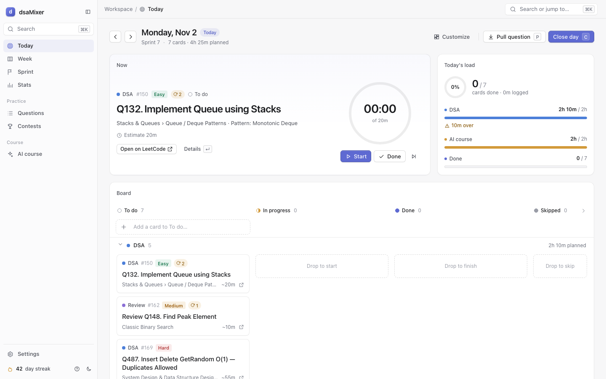

# dsaMixer

A daily board that mixes 507 DSA questions with your course schedule and re-plans every night.

## What it is

dsaMixer is a local Kanban planner. Each day it lays out DSA questions from different topics, spaced-repetition reviews, contests and your AI-course class and homework cards. You log the day in the evening, and it plans tomorrow from what is left. It runs on your machine: no account, no cloud, no API key needed.



## Features

**Daily planning**
- Topic mix: each new question of the day comes from a different topic (13 sections, Graphs, DP and Trees weighted double), e.g. Hard + Medium + Easy.
- Weekly layout: the whole week's DSA mix goes on the board at once, so the Week view shows it.
- Rest days: pick days with no DSA (default Sat and Sun). Sunday is a buffer day with a retro card.
- Friday catch-up: Friday drops the Hard to leave room for leftovers.
- Carry-over: unfinished cards move to the next day.

**Spaced repetition**
- Reviews come back after 3, 7, 21 and 45 days (sooner if you needed hints), then the question counts as mastered.
- A confident first solve gets one check after 21 days.

**Contests and the badge goal**
- Calendar sync: the real Weekly and Biweekly schedule is fetched from LeetCode.
- Progression: virtual contests in the first weeks, then live ones. Missed problems become upsolve cards.
- Badge target: Knight (~1850), Guardian (~2150) or a custom rating, with a deadline and a tracker.
- LeetCode profile card: avatar, solved E/M/H, rating, global rank, top %, streak and badges.
- Friends leaderboard: add friends' usernames and compare ratings on the Contests page.
- Auto-logged contests: attended contests are logged for you, with upsolve cards.
- Already-solved suggestions: recent LeetCode solves that match your list can be accepted in one click (only the last ~20 are visible).

**AI course**
- Weekly AI planner: an LLM breaks your goals into tasks, and plain code spreads them over your days.
- Homework agents (Claude Code): `/homework-plan` and `/homework-sync` split homework into steps and tick them off from your notebooks. They never write solutions.

**Stats and UI**
- Heatmap, topic coverage and a projected finish date.
- Week and Sprint views with a weekly retro.
- `⌘K` palette searches pages, actions and all 507 questions.
- Widgets on Today and Stats can be dragged, hidden and resized.
- Light and dark themes, a timer, and keyboard shortcuts (`?` lists them).

**Optional**
- Morning (8:00) and evening (22:00) emails through Gmail (scheduled by launchd on macOS; use cron on Linux).

## Get started in 2 minutes

Needs Python 3.10+ and macOS, Linux or Windows with WSL. The `.env` keys are all optional.

With [Claude Code](https://claude.com/claude-code):

```sh
git clone https://github.com/prathamjain0016/dsaMixer
cd dsaMixer
claude
# then type /setup
```

`/setup` asks about your schedule and goal, installs the packages, saves your plan and starts the board.

Without it:

```sh
git clone https://github.com/prathamjain0016/dsaMixer
cd dsaMixer
./run.sh
```

Open <http://127.0.0.1:8765>. A short browser wizard sets your start date, DSA minutes, course and goal. Full steps: [getting started](guides/getting-started.md).

## Daily use

1. Morning: open the board, or run `./run.sh today` for the plan in the terminal.
2. During the day: drag cards to Done, or press `x`. DSA cards ask for result, minutes and confidence.
3. Evening: click Close day. It logs the day and plans tomorrow.
4. Sunday: review the week in the retro card and do the contest.
5. Homework: drop files in `homework/weekN/`, then run `/homework-plan N` once and `/homework-sync N` as you work. See [homework agents](guides/homework-agents.md).

## Customise

- Settings page: budgets, time estimates, contests, LeetCode, and the full config as JSON under Advanced.
- `/setup --reconfigure` in Claude Code, or Settings, Run setup again.
- Config file: copy `config.example.json` to `config.local.json`, keep only the keys you want, then run `./run.sh config import config.local.json`.
- Code: the UI is vanilla JS with no build step, and SQL is plain. Both are easy to change.

Every key is listed in [customise](guides/customise.md). Optional keys and email setup are in [integrations](guides/integrations.md).

## How it's built

FastAPI serves a JSON API and a vanilla-JS UI. Data is in SQLite by default, or Postgres if you set `DATABASE_URL`. The planner is plain rules in `dsamixer/planning/planner.py`, so every scheduling choice is deterministic. Only the AI planner calls an LLM. The Claude Code agents change data only through `./run.sh`. More in [system design](architecture/system-design.md).

## Paste in the group

```text
I built a local planner for the course: dsaMixer. 📅
It mixes 507 DSA questions with our class and homework schedule, re-plans each night,
does spaced repetition, and syncs LeetCode contests and your profile.
Runs on your laptop, no account or API key. Needs Python 3.10+.
Setup: clone it, run `claude`, type /setup. Or just run ./run.sh.
https://github.com/prathamjain0016/dsaMixer
```
